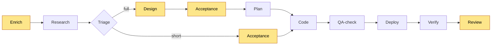

# feature-workflow

**A coding agent writes fast. You still re-check everything. This moves the bottleneck back to code.**

`feature-workflow` runs a feature or a bugfix through a fixed chain of phases. Every phase writes one short artifact, a **deterministic gate** (a script, not a model) checks it, judges from a *different model class* review the design and the code, and **you decide only at fixed points**: what we build, how, what "done" means, and the final review. You get a pass/fail report with numbers instead of re-verifying from scratch.

[Русская версия → README.ru.md](README.ru.md)



Yellow = a human decision. Every arrow passes a gate: exit `0` go on, `1` the agent fixes it, `2` stop and ask you.

## Why

| Problem | What the workflow does |
|---|---|
| The agent "finishes" and you re-read everything | A gate script checks every artifact; the agent cannot move on until it passes |
| The agent quietly redesigns mid-code | Code that leaves the agreed file list or needs a bigger design exits `2` — you choose *fix in code* or *back to Design* |
| The author reviews its own work | Judges run on the **other** model class than the author (opus writes → sonnet judges, and back) |
| Acceptance criteria drift to fit the result | The approved criteria are snapshotted; changing a threshold fails the QA-check gate |
| Small tasks drown in ceremony | Triage picks a **short cycle** (no Design/Plan/QA-check) when the change is small and safe |

## Install (Claude Code)

```
/plugin marketplace add SergeyKarpenko1/feature-workflow
/plugin install feature-workflow@feature-workflow
```

Then in your project: `/feature my-feature`. On the first run the skill asks five short questions (agent, tracker, whether to print a tracker card, base branch, check commands) and writes `.feature/config.toml` — only after you say yes.

Requirements: Python ≥ 3.11 (`tomllib`), `git`.

> Status: **v0.1, Claude Code only.** Codex CLI and Antigravity adapters are designed (see [`docs/design.md`](docs/design.md)) but not built yet.

## The phases

| Phase | Who writes | Artifact | You |
|---|---|---|---|
| Enrich | agent interviews you | `01-enrich.md` | answer, confirm |
| Research | read-only subagent | `02-research.md` | — |
| Triage | gate | `cycle: short \| full` | may force `full` |
| Design | agent, then **design-judge** | `03-design.md` | **"design accepted"** |
| Acceptance | agent | `04-acceptance.md` | **"approved"** (snapshotted) |
| Plan | read-only subagent | `05-plan.md` (≤ 150 lines, no big code) | — |
| Code | agent, then **arch-judge** | the diff | only on escalation |
| QA-check | agent | `07-qa-check.md` | — |
| Deploy / Verify | agent | `09-report.md` | `manual` criteria |
| Review | you | — | read report + diff, commit |

The agent **never commits or pushes**. Edits are allowed only after you grant them for the current branch, recorded as `edits_allowed:` in the feature's `STATE.md`.

## Configuration

`.feature/config.toml` in your project ([full example](examples/config.example.toml)):

```toml
base_branch = "main"
features_dir = "docs/features"

[tracker]
kind = "jira"        # or "none"
task_card = true     # print title + description for the tracker after Enrich

[checks]
commands = ["pytest -q", "ruff check ."]   # any shell commands; all must exit 0
known_failures = ""                        # tolerated pytest failures (baseline)

[triage]
max_short_files = 3
rules = [{ reason = "touches a contract", pattern = "^migrations/|schema" }]
```

## What it does *not* protect

Be clear about the limits:

- The scope gate compares the git diff with the research file list; it cannot see what a file *means*.
- Judges are models. They reduce, not remove, the chance of a wrong design getting through.
- The plugin cannot stop an agent from reading secrets by itself — configure your agent's permission rules for `.env`/credentials. The skill instructs against it; instructions are not enforcement.
- Your `checks.commands` run through the shell as written: they are your code, review them like any CI config.

## Repository layout

```
.claude-plugin/        plugin.json, marketplace.json
skills/feature/        SKILL.md, scripts/feature_gate.py, templates/
agents/                design-judge.md, arch-judge.md
examples/              config.example.toml
tests/                 gate tests (pytest)
docs/                  design and implementation plan of the universal version
```

Run the tests: `python3 -m pytest tests`.

## Roadmap

See [`docs/plan-v1.md`](docs/plan-v1.md): Codex CLI and Antigravity adapters, config-driven judge command (a judge from another *vendor*), a write-guard hook, ru/en artifact templates.

## License

MIT — see [LICENSE](LICENSE).
