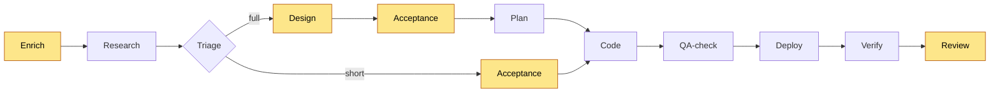

# feature-workflow

**Агент пишет код быстро, а вы всё равно перепроверяете за ним. Плагин возвращает узкое место обратно в код.**

`feature-workflow` проводит фичу или багфикс через фиксированную цепочку фаз. Каждая фаза пишет короткий артефакт, его проверяет **детерминированный гейт** (скрипт, не модель), дизайн и код смотрят судьи **другого класса моделей**, а **вы решаете только в фиксированных точках**: что делаем, как, что считать «готово» и финальное ревью. Вместо проверки с нуля вы получаете отчёт «прошло / не прошло» с цифрами.

[English version → README.md](README.md)



Жёлтое — решение человека. После каждой стрелки гейт: код `0` — дальше, `1` — агент чинит, `2` — стоп и вопрос вам.

## Зачем

| Проблема | Что делает плагин |
|---|---|
| Агент «закончил», а вы перечитываете всё | Скрипт-гейт проверяет каждый артефакт; пока не пройден, дальше нельзя |
| Агент тихо меняет дизайн по ходу кода | Выход за согласованный список файлов или нужда в большем дизайне даёт код `2`: вы выбираете «чинить в коде» или «назад в Design» |
| Автор сам проверяет свою работу | Судья работает на **другом** классе модели (пишет opus — судит sonnet, и наоборот) |
| Критерии приёмки подгоняют под результат | Утверждённые критерии снимаются снимком; смена порога роняет гейт QA-check |
| Мелкая задача тонет в церемониях | Triage выбирает **короткий цикл** (без Design/Plan/QA-check), если правка маленькая и безопасная |

## Установка

| Агент | Статус | Установка |
|---|---|---|
| **Claude Code** | работает | `/plugin marketplace add SergeyKarpenko1/feature-workflow`, затем `/plugin install feature-workflow@feature-workflow` |
| **Codex CLI** | адаптер написан, **сквозно ещё не проверен** | ниже |
| Antigravity CLI, другие | не написано | гейты и шаблоны работают везде; скилл идёт в *inline-режиме* (без независимого судьи) |

**Codex CLI** (проверено лишь то, что установленный `codex 0.139` принимает эти команды, а файлы разбираются):

```bash
codex plugin marketplace add SergeyKarpenko1/feature-workflow   # Codex читает marketplace.json в стиле Claude
codex plugin add feature-workflow
git clone https://github.com/SergeyKarpenko1/feature-workflow /tmp/fw
python3 /tmp/fw/scripts/install_codex_agents.py                  # два судьи -> ./.codex/agents/
```

Плагины Codex несут скиллы, но не кастомных агентов, поэтому нужен отдельный шаг. Судьи Codex наследуют права родителя: «только чтение» держится на инструкции. Для жёсткой гарантии запускайте судью через `codex exec -s read-only`.

Дальше в проекте: `/feature my-feature` (Codex: назовите скилл `feature`). При первом запуске скилл задаёт несколько коротких вопросов (агент, трекер, нужна ли карточка для трекера, базовая ветка, команды проверок, две модели) и пишет `.feature/config.toml` — только после вашего «да».

Нужно: Python ≥ 3.11 (`tomllib`), `git`.

## Фазы

| Фаза | Кто пишет | Артефакт | Вы |
|---|---|---|---|
| Enrich | агент опрашивает вас | `01-enrich.md` | отвечаете, подтверждаете |
| Research | субагент, только чтение | `02-research.md` | — |
| Triage | гейт | `cycle: short \| full` | можете поднять до `full` |
| Design | агент, затем **design-judge** | `03-design.md` | **«дизайн принят»** |
| Acceptance | агент | `04-acceptance.md` | **«утверждаю»** (снимок) |
| Plan | субагент, только чтение | `05-plan.md` (≤ 150 строк, без больших блоков кода) | — |
| Code | агент, затем **arch-judge** | дифф | только при эскалации |
| QA-check | агент | `07-qa-check.md` | — |
| Deploy / Verify | агент | `09-report.md` | `manual`-критерии |
| Review | вы | — | читаете отчёт и дифф, коммитите |

Агент **никогда не коммитит и не пушит**. Правки разрешены только после вашего согласия для текущей ветки; оно записано как `edits_allowed:` в `STATE.md` фичи.

## Настройка

`.feature/config.toml` в вашем проекте ([полный пример](examples/config.example.toml)):

```toml
base_branch = "main"
features_dir = "docs/features"

[tracker]
kind = "jira"        # или "none"
task_card = true     # после Enrich выдать название и описание задачи для трекера

[models]
strong = "opus"    # решающие фазы; Codex: любая ваша модель
fast = "sonnet"     # остальное; судья всегда другого класса

[checks]
commands = ["pytest -q", "ruff check ."]   # любые shell-команды; все должны вернуть 0
known_failures = ""                        # допустимые падения pytest (baseline)

[triage]
max_short_files = 3
rules = [{ reason = "затрагивает контракт", pattern = "^migrations/|schema" }]
```

## Чего плагин *не* гарантирует

- Гейт границ сравнивает git-дифф со списком файлов из research; смысла файла он не видит.
- Судьи — модели. Они снижают, но не убирают риск неверного дизайна.
- Плагин не может запретить агенту читать секреты сам: настройте правила доступа вашего агента для `.env` и файлов с ключами. Скилл это запрещает инструкцией, а инструкция — не принуждение.
- Команды из `checks.commands` выполняются через shell как написаны: это ваш код, проверяйте их как любой CI-конфиг.

## Структура репозитория

```
.claude-plugin/        plugin.json, marketplace.json
skills/feature/        SKILL.md (не привязан к агенту), scripts/feature_gate.py, templates/
judges/                единственный источник двух промптов судей
agents/                генерируется для Claude Code     (scripts/build_adapters.py)
adapters/codex/agents/ генерируется для Codex CLI       (копирует scripts/install_codex_agents.py)
examples/              config.example.toml
tests/                 тесты гейтов и адаптеров (pytest)
docs/                  дизайн и план реализации универсальной версии
```

Промпты судей правьте только в `judges/`, затем `python3 scripts/build_adapters.py`. Тесты: `python3 -m pytest tests`.

## Планы

См. [`docs/plan-v1.md`](docs/plan-v1.md): адаптер Antigravity, судья командой из конфига (модель другого *вендора*), хук-охранник записи, шаблоны артефактов ru/en.

## Лицензия

MIT — см. [LICENSE](LICENSE).
